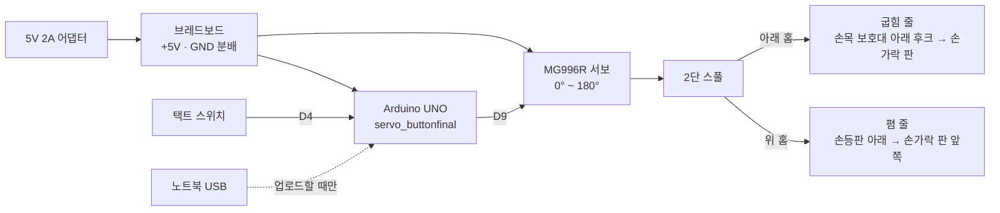

# 능동형 손 재활 보조기 및 제어 시스템 개발

**Active Hand Rehabilitation Orthosis with Servo-Driven Flexion·Extension Control**

손등 화상 환자가 집에서도 손가락 굽힘·폄 운동을 반복할 수 있도록, 서보모터가 줄을 감았다 풀어 손가락을 굽히고 펴 주는 착용형 손 재활 보조기와 버튼 하나로 조작하는 제어 펌웨어를 개발했습니다.

| 교과목 | 팀 | 팀원 | 지도교수 | 기간 |
| :---: | :---: | :---: | :---: | :---: |
| 소프트웨어캡스톤디자인 (2026-2, 연구형) | 새콤달콤 | 강태우, 김한결, 정수아 | 최가영 교수님 | 2026.09 ~ 2026.11 |


## Quick Links

- [`demo.md`](demo.md): 최종 시연 영상
- [`capstone_progress_2026_11_17-11_22.md`](capstone_progress_2026_11_17-11_22.md): 최종 구조, 줄 배치, 펌웨어, 시연 (가장 최근 기록)
- [`firmware/servo_buttonfinal/servo_buttonfinal.ino`](firmware/servo_buttonfinal/servo_buttonfinal.ino): 최종 펌웨어
- [`capstone_progress_2026_11_12.md`](capstone_progress_2026_11_12.md): 지도교수 면담, 모터 재선정, 줄 거는 방식 A~E 3D 시뮬레이션 비교

## Abstract

- **배경:** 손등에 화상을 입으면 피부가 굳으면서 **구축**(관절이 굳어 움직이는 범위가 줄어드는 현상)이 생겨 손 기능이 제한됩니다. 이를 막으려면 주먹을 쥐고 펴는 운동을 매일 반복해야 합니다. 근전도(EMG) 기반 로봇 재활 훈련이 손 기능과 비후성 반흔 개선에 효과가 있다고 보고되었지만[1], 이런 장비는 병원에서만 쓸 수 있습니다.
- **문제:** 집에서 쓰는 너클 밴더(고무줄로 손가락을 당기는 보조기)는 투박하고 착용이 불편하며, 고무줄 장력을 세밀하게 조절하기 어렵고, 반복 운동은 환자가 직접 힘을 써야 합니다.
- **방법:** MG996R 서보모터 1개와 2단 스풀로 굽힘 줄과 폄 줄을 서로 반대 방향으로 감아, 모터 하나로 손가락을 굽히고 펴도록 설계했습니다. 손목 보호대 위 받침판, 3D 프린팅 손등판·손가락 판, 벨크로, 펠트지로 착용부를 만들고, 버튼 하나로 굽힘·폄·정지·재활 모드·유지 모드를 실행하는 펌웨어를 작성했습니다.
- **결과:** 최종 시연에서 버튼 하나로 굽힘·폄, 중간 정지, 재활 모드 5회 반복, 유지 모드가 모두 동작했습니다. 펌웨어를 올린 뒤에는 컴퓨터 없이 5V 2A 어댑터로 구동됩니다.
- **의의:** 저렴하고 흔한 부품으로 수동 고무줄 보조기와 병원용 로봇 재활 장비 사이를 채우는 능동형 착용 보조기를 구현했고, 회로·코드·진행 기록을 모두 공개해 누구나 다시 만들 수 있습니다.

## Project Highlights

- **양방향 능동 구동:** 서보모터 1개 + 2단 스풀(기존 지름 3cm 스풀 2개를 붙여 제작)로 굽힘과 폄을 모두 모터가 만듭니다.
- **손가락 중심 운동:** 손목이 아니라 손가락 판(MCP 관절)을 굽혀 손등 피부를 늘리도록 줄 경로를 설계했습니다.
- **버튼 하나로 조작:** 누르는 횟수와 시간으로 기능을 나누고, 1°씩 20ms 간격으로 움직여 갑작스러운 동작을 막습니다.
- **가볍고 단순한 구조:** 시험 단계에서 쓴 로드셀(HX711)은 완성본에서 빼고 서보 각도만으로 제어합니다.
- **설계 근거:** 너클 밴더 고리 간격(편 손 14cm → 쥔 손 11cm), 필요 토크 계산(약 0.44 N·m), 줄 이동 실측(약 0.7cm)으로 부품과 각도를 정했습니다.

## System Overview


*최종 구조 3D 시뮬레이션 (김한결 작성) — 서보 0°에서 손가락을 펴고(좌), 180°에서 굽힙니다(우).*



- 서보 전원은 어댑터에서 따로 공급하고, 어댑터 GND와 아두이노 GND를 공통으로 연결합니다.
- 보드의 리셋 버튼을 비상 정지로 사용합니다.

## Button Control

| 버튼 조작 | 동작 |
| :--- | :--- |
| 한 번 / 한 번 더 누름 | 180° 굽힘 / 0° 폄 |
| 움직이는 중 한 번 | 반대 방향으로 전환 |
| 빠르게 두 번 (0.2초 안) | 그 자리에서 정지·유지 |
| 2초 이상 누름 | 재활 모드: 굽힘 ↔ 폄 5회 반복 |
| 5초 이상 누름 | 유지 모드: 180°에서 3초 유지 후 폄 |
| 보드 리셋 버튼 | 비상 정지 |

## Hardware

| 구분 | 구성 |
| :--- | :--- |
| 제어 | Arduino UNO 호환 보드, 택트 스위치(D4, INPUT_PULLUP) |
| 구동 | MG996R 서보(D9), 2단 스풀(지름 3cm) |
| 전원 | 5V 2A 어댑터 → DC 단자 → 브레드보드 (GND 공통) |
| 착용부 | 손목 보호대 + 3mm 포맥스 받침판, 3D 프린팅 손등판·손가락 판, 벨크로, 펠트지 |
| 줄 경로 | 테이프식 후크(손목 보호대 아래), 굽힘 줄 2가닥, 폄 줄 1가닥 |
| 시험용 | HX711 + 2kg 로드셀 (완성본 미사용) |

## Repository Structure

```
capstone-2026/
├── README.md
├── demo.md                          # 시연 영상
├── capstone_progress_2026_10_19.md  # 설계 기준, Wokwi 가상 검증, 전원·배선, 1차 조립
├── capstone_progress_2026_11_02.md  # HX711·로드셀 납땜, 서보 받침판, 3D 프린팅 부품 가공
├── capstone_progress_2026_11_09.md  # 1차 통합 시험 (MG90S 헛돎)
├── capstone_progress_2026_11_12.md  # 지도교수 면담, 모터 재선정, A~E 시뮬레이션
├── capstone_progress_2026_11_17-11_22.md  # 최종 구조, 펌웨어, 시연
├── firmware/
│   ├── servo_buttonfinal/servo_buttonfinal.ino  # 최종 펌웨어 (Arduino IDE)
│   ├── src/main.cpp                 # 로드셀 힘 상한 버전 (PlatformIO, 참고용)
│   └── platformio.ini
├── wokwi/                           # Wokwi 가상 회로 (sketch, diagram, libraries)
└── images/                          # 보고서용 사진
```

## Getting Started

**최종 펌웨어 업로드 (Arduino IDE)**

1. `firmware/servo_buttonfinal/servo_buttonfinal.ino`를 Arduino IDE로 엽니다.
2. 보드를 Arduino UNO로 선택하고 USB로 업로드합니다.
3. 업로드 후 USB를 빼고, 5V 2A 어댑터로 서보와 보드에 전원을 공급합니다.
4. 시리얼 모니터(9600 baud)에서도 각도 입력, `r`(재활 모드), `h`(유지 모드), `x`(정지)로 시험할 수 있습니다.

**가상 회로 (Wokwi)**

- `wokwi/` 폴더의 `sketch.ino`, `diagram.json`, `libraries.txt`를 Wokwi 프로젝트에 불러오면 서보·HX711·버튼 배선을 가상으로 확인할 수 있습니다.

## Limitations & Future Work

- **각도 재조정:** 180°에서 줄이 약 4.7cm 감겨 실제 필요량(약 0.7~1cm)보다 많아, 사용자에 맞게 각도를 다시 맞춰야 합니다.
- **안전 정지:** 지금은 리셋 버튼에 의존하며, 힘 센서로 과도한 힘을 감지해 자동으로 멈추는 기능이 필요합니다.
- **전원 구성:** 브레드보드 없이 구동하려면 더 큰 용량의 전원과 전용 기판이 필요합니다.
- **검증:** 실제 환자를 대상으로 한 검증과 손 크기별 부품 제작은 추후 과제입니다.
- **향후 방향:** 힘 센서 안전 정지, 전용 기판·배터리, 의료용 실리콘 패드 → 손 치수 맞춤 3D 프린팅 → 구매·대여와 앱 기반 운동 기록. 의료기기로 판매하려면 식약처 허가·인증(전기·기계 안전, 전자파, 사용적합성, GMP)을 준비해야 하며, 움직임 상상 뇌파(EEG) 기반 BCI 제어로 확장할 계획입니다.

## References

[1] Lee, S. Y., Seo, C. H., Cho, Y. S., Seo, J., & Joo, S. Y. (2025). Functional improvement and scar impact of electromyography (EMG)-driven robotic training on nerve damage and hypertrophic scars in hands that underwent skin grafting after burns: a prospective, randomized, single-blinded study. *International Journal of Surgery*, 111(11), 8108–8119. https://doi.org/10.1097/JS9.0000000000003052
