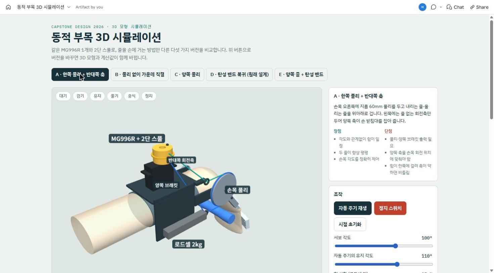
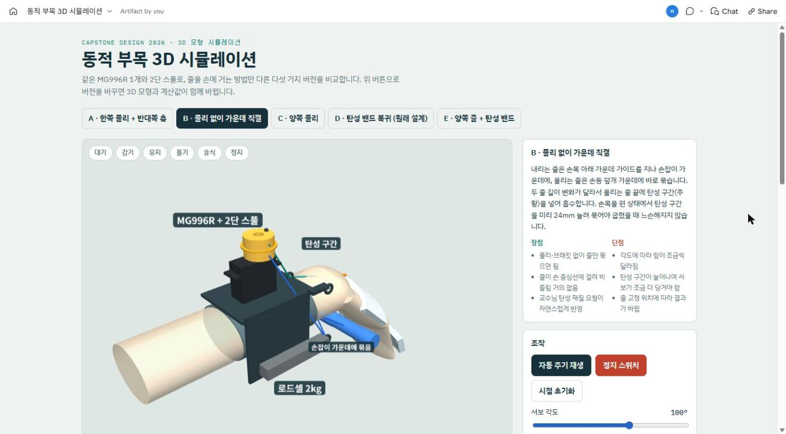
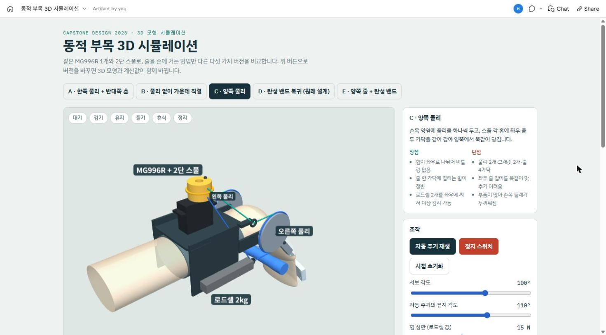
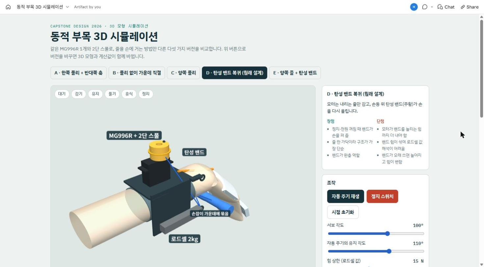
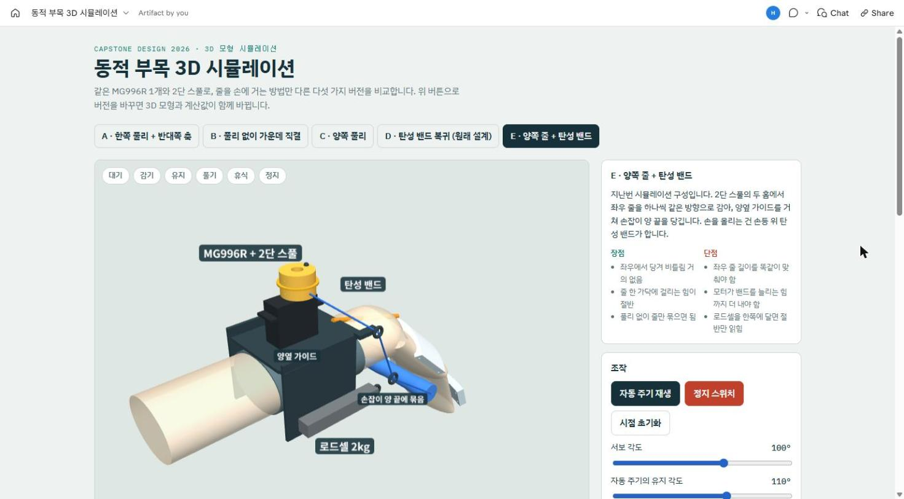

# 캡스톤 디자인 교수님 면담 회의록 (2026.11.12)

* **과제명:** 능동형 손 재활 보조기 및 제어 시스템 개발
* **면담일:** 2026년 11월 12일 (목)
* **참석자:** 강태우, 김한결, 정수아, 지도교수님
* **저장소:** [sweetndsour/capstone-2026](https://github.com/sweetndsour/capstone-2026)

## 1. 면담 배경

* 11월 9일 전체 연동 테스트에서 시제품이 의도대로 동작하지 않았습니다.
  * MG90S 서보모터의 힘이 부족해 스풀이 **헛도는 현상**이 발생했습니다.
  * 실(견인 줄) 방식으로는 부목에 장력이 안정적으로 전달되지 않았습니다.
* 이 결과를 바탕으로 교수님께 시제품을 보여드리고 개선 방향에 대한 피드백을 받았습니다.

## 2. 교수님 피드백 및 결정 사항

| 구분 | 내용 | 비고 |
| :--- | :--- | :--- |
| **모터 배치** | 모터를 손목 받침판 **위쪽**으로 가도록 재배치 | 기존: 받침판에 눕혀 배치 |
| **모터 수량** | 모터 **2개 사용 확정** | |
| **모터 사양** | 현재(MG90S)보다 **토크가 강한 모터**로 교체 | 헛도는 현상 해결 목적 |
| **견인 소재** | 실 대신 **탄성(장력) 있는 고무 재질**로 교체 | 아래 세부 조건 참고 |
| **전원·회로** | 전원을 아두이노 보드에 직접 연결해 **브레드보드 제거** 검토 | 장치 경량화 목적 |
| **소프트웨어** | 제어 코드를 아두이노 보드에 직접 업로드해 **단독 구동** 검토 | |
| **구현 우선순위** | **굽히는(굴곡) 동작 먼저** 구현 | 펴는 동작은 이후 진행 |

### 탄성 소재 세부 조건

* 고무줄처럼 고리 형태로 이어진 것이 아니라, **기존 실처럼 원하는 길이로 잘라 쓸 수 있는 형태**여야 합니다.
* 이전에 사용해 본 고무보다 **너비와 두께가 얇아야** 합니다.

## 3. 향후 할 일 (Action Items)

| 할 일 | 담당 | 기한 |
| :--- | :--- | :--- |
| 고토크 모터 후보 조사 | 전원 | 최대한 빠르게 |
| 탄성 소재(절단 가능한 얇은 고무 끈) 조사 | 전원 | 최대한 빠르게 |
| 모터 + 탄성 소재 **견적서 작성 후 교수님께 송부** | 전원 | 최대한 빠르게 |
| 주문 및 배송 수령 | 전원 | 견적 승인 후 |
| 모터 위쪽 배치로 기구부 재설계 | 강태우·정수아 | 부품 수령 후 |
| 브레드보드 제거 회로 구성 및 아두이노 단독 구동 | 김한결 | 부품 수령 후 |
| 굽히는 동작 우선 구현 및 테스트 | 전원 | 부품 수령 후 |

## 4. 면담 이후 설계 검토 (11/12 ~ 11/13)

면담 피드백을 바탕으로 모터 선정, 필요한 힘 계산, 스풀·줄 재료를 검토했다.

### 모터 헛돎 원인 구분

- 헛도는 현상은 모터 힘 부족 외에도 서보 혼–스풀 미끄러짐, 줄 미끄러짐, 부하 과다, 기구 걸림, 전원 부족이 원인일 수 있어 나눠서 확인하기로 했다.
- MG90S의 표기 1.8kgf·cm는 줄을 1.8kgf로 당긴다는 뜻이 아니다. 실제 당기는 힘은 스풀 반지름과 줄 경로에 따라 달라진다.

### 필요한 힘 계산

| 항목 | 값 |
|---|---|
| 손 무게 / 무게중심 | 약 0.42kg / 손목에서 약 6.5cm |
| 손바닥이 아래인 자세에서 60° 굽힘에 필요한 토크 | 약 0.44 N·m (줄 장력 약 15N) |
| MG996R + 지름 60mm 풀리로 낼 수 있는 손목 토크 | 약 0.61 N·m → 여유 있음 |
| 참고 | 기능적 손목 가동 범위 약 40°, 화상 부목은 손목 약 20° 신전·MCP 50~70° 굴곡 자세가 일반적 |

### 결정 사항

| 구분 | 내용 |
|---|---|
| **구동 모터** | **MG996R** (MG90S는 힘 부족) |
| **장력 센서** | 로드셀 1개 + HX711로 줄 장력 측정 (상한 15N) |
| **스풀** | 2단 스풀 지름 30mm (3D 프린팅). 홈 2개에 두 줄을 서로 반대 방향으로 감음 |
| **손목 풀리** | 지름 60mm (3D 프린팅). 줄이 손목 축 아래(손바닥 쪽)를 지나게 해서 손목을 굽히는 힘을 확보 |
| **줄 재료** | 우레탄줄, 고무줄, 낚싯줄, 왁스줄을 비교하고 견적을 냄 |

- 교수님께는 줄 미끄러짐은 해결할 수 있고, 기존 줄로 고정하는 방법도 조사했다는 내용으로 메시지를 보냈다.
- 2단 스풀과 손목 풀리는 STL 파일로 만들었다.

### 3D 시뮬레이션 — 줄 거는 방식 A~E 비교

같은 MG996R 1개와 2단 스풀로, 줄을 손에 거는 방법만 다른 다섯 가지 버전을 3D 모형으로 비교했다.

- 시뮬레이션 페이지: [동적 부목 3D 시뮬레이션](https://claude.ai/artifact/6iUgcSkFJShfg8Qz4w78pD) (버전을 바꾸며 서보 각도와 계산값을 직접 확인할 수 있음)

| 버전 | 구성 | 장점 | 단점 |
|---|---|---|---|
| **A · 한쪽 풀리 + 반대쪽 축** | 손목 오른쪽에 지름 60mm 풀리를 두고 내리는 줄·올리는 줄을 위아래로 검. 왼쪽에는 줄 없는 회전축만 둠 | 각도와 관계없이 힘이 일정, 두 줄이 항상 팽팽, 손목 각도를 정확히 제어 | 풀리·양쪽 브래킷 출력 필요, 양쪽 축을 손목 회전 위치에 맞춰야 함, 힘이 한쪽에 걸려 비틀릴 수 있음 |
| **B · 풀리 없이 가운데 직결** | 내리는 줄은 손목 아래 가운데 가이드를 지나 손잡이 가운데에, 올리는 줄은 손등 덮개 가운데에 바로 묶음. 올리는 줄 끝에 탄성 구간을 넣어 길이 차이를 흡수 | 풀리·브래킷 없이 줄만 묶으면 됨, 비틀림 거의 없음, 교수님의 탄성 재질 요청이 자연스럽게 반영 | 각도에 따라 힘이 조금씩 달라짐, 탄성 구간 때문에 서보가 더 당겨야 함, 줄 고정 위치에 따라 결과가 바뀜 |
| **C · 양쪽 풀리** | 손목 양옆에 풀리를 하나씩 두고 좌우 줄 두 가닥을 같이 감아 양쪽에서 똑같이 당김 | 비틀림 없음, 줄 한 가닥에 걸리는 힘이 절반, 로드셀 2개로 이상 감지 가능 | 풀리 2개·브래킷 2개·줄 4가닥, 좌우 줄 길이 맞추기 어려움, 손목 둘레가 두꺼워짐 |
| **D · 탄성 밴드 복귀 (원래 설계)** | 모터는 내리는 줄만 감고, 손등 위 탄성 밴드가 손을 다시 올림 | 정지·전원 꺼짐 때 밴드가 손을 펴 줌, 구조가 가장 단순, 밴드가 완충 역할 | 모터가 밴드를 늘리는 힘까지 내야 함, 로드셀 값 해석이 어려움, 밴드가 오래 쓰면 늘어짐 |
| **E · 양쪽 줄 + 탄성 밴드** | 2단 스풀의 두 홈에서 좌우 줄을 같은 방향으로 감아 양옆 가이드를 거쳐 손잡이 양 끝을 당김. 손을 올리는 건 탄성 밴드 | 비틀림 거의 없음, 줄 한 가닥에 걸리는 힘이 절반, 풀리 없이 줄만 묶으면 됨 | 좌우 줄 길이를 맞춰야 함, 모터가 밴드 힘까지 내야 함, 로드셀을 한쪽에 달면 절반만 읽힘 |

| A · 한쪽 풀리 + 반대쪽 축 | B · 풀리 없이 가운데 직결 |
|---|---|
|  |  |
| **C · 양쪽 풀리** | **D · 탄성 밴드 복귀 (원래 설계)** |
|  |  |
| **E · 양쪽 줄 + 탄성 밴드** | |
|  | |
